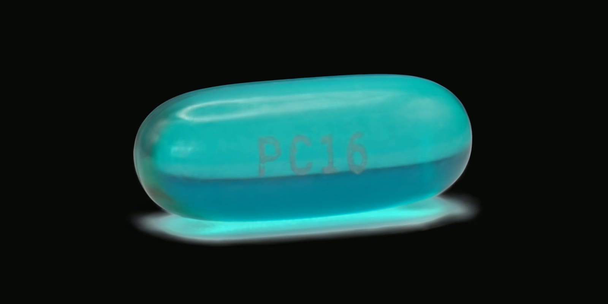
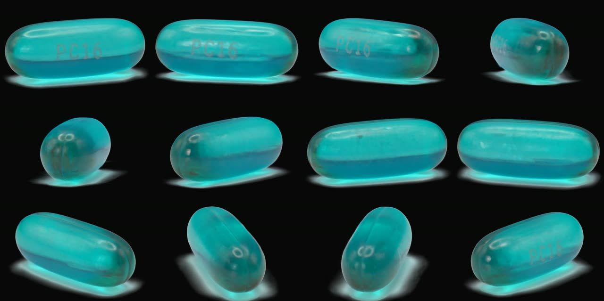
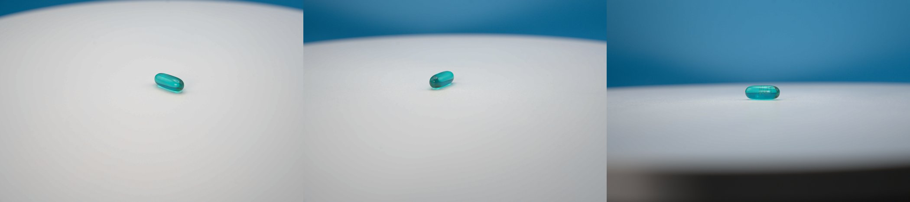

# Turntable Gaussian splat of a clear softgel capsule



A 3D Gaussian splat of a 20 mm clear teal softgel capsule and its reflection on the table, made from 189 turntable photos. Standard photogrammetry (COLMAP, VGGT) can't pose this kind of shoot. This repo uses a different route: it recovers the camera poses from the capsule's **silhouettes**, then trains the splat with Brush.

Everything needed to reproduce the result is here: the raw photos (as a release download), every script, the exact settings, and the results.

| Result | File |
|---|---|
| Gaussian splat (151K splats, 3 SH bands) | [`results/final.ply`](results/final.ply) |
| Offline viewer, open in a browser | [`results/final-viewer.html`](results/final-viewer.html) |
| Orbit video, 3840×2160 | [`results/orbit-4k.mp4`](results/orbit-4k.mp4) |
| Orbit video, 1080×1080 | [`results/orbit.mp4`](results/orbit.mp4) |



## Why the usual route fails

On a turntable the camera stays still and the object turns, so the background never moves and gives no camera motion. A clear softgel on a plain white table has almost no stable texture. On the first capture, COLMAP registered 2 of 156 frames, and VGGT's poses were too noisy to train on.

What the photos do give reliably is the capsule's **outline**. As the table turns, the outline traces a predictable path. From those outlines you can solve the camera height, distance and table angle for every frame, write the cameras in COLMAP format, and train Brush on them directly.

## The capture



- Sony ILCE-7M4 (a7 IV) with a Sigma 24-70mm F2.8 DG DN II Art at 70 mm. Manual exposure: 1/125 s, f/7.1, ISO 250.
- The capsule sat on a white turntable in front of a blue backdrop.
- There were three camera heights: 65, 59 and 65 shots, 189 frames in total. Only the tripod moved between heights, never the capsule.
- The solved camera heights are 26.1°, 15.1° and 4.5° above the table.
- Full notes: [`docs/capture-round2.md`](docs/capture-round2.md).

### Download the raw photos

The 189 Sony `.ARW` files (6.8 GB) are attached to the [**`round2-raw` release**](../../releases/tag/round2-raw) as four zip parts. `SHA256SUMS.txt` there lists a checksum for every file. Unzip all the parts into `assets/Round-2/`.

## Pipeline

```
 .ARW raw photos
   │  develop/develop_v2.py        rawpy (LibRaw): one fixed white balance, gain, tone curve and denoise for every frame
   ▼
 assets/Round-2-Edited/*.png       7008×4672 sRGB
   │  cutout/sam_track.py          SAM 2.1 video tracking: one box per ring, propagated through the ring
   │  cutout/finalize_masks.py     binarize, keep the largest piece, fill holes
   ▼
 assets/Round-2-Mask/*.png         capsule only → for the pose solver
   │  cutout/make_cutout.py        capsule mask + colour-keyed cyan reflection as soft alpha
   ▼
 assets/Round-2-Cutout/*.png       RGBA, capsule + reflection → for Brush
   │  pose/capture_info.py --times per-frame capture time from EXIF
   │  pose/run_turntable.py        prep → measure → fit → export → check → final → viewer
   ▼
 final.ply, final-viewer.html
   │  pose/make_track.py + splat-transform + ffmpeg
   ▼
 orbit-4k.mp4
```

### What `run_turntable.py` does

It runs these stages in order and stops at the first gate that fails:

| Stage | What it does | Gate |
|---|---|---|
| `prep` | crops images and masks to one centred window | sizes and names match |
| `measure` | per-frame silhouette centroid and size; detects rings | one clean piece per mask, ≥ 8 shots per ring |
| `fit` | fits camera height, distance, pan/tilt drift and per-frame table angle by matching rendered silhouettes to the masks (differentiable voxel renderer in PyTorch) | mean IoU ≥ 0.99 per ring, even rotation steps, centroids follow an ellipse |
| `export` | writes COLMAP `cameras/images/points3D` text files, plus start points mirrored through the table for the reflection | every image present and RGBA |
| `check` | trains Brush for 6,000 iterations with every 8th view held out, then measures PSNR | held-out PSNR ≥ 23 dB |
| `final` | trains Brush for 30,000 iterations on all views | `final.ply` exists |
| `viewer` | exports the self-contained HTML viewer | |

## Setup

Tested on Windows 11 with an RTX 5090 (CUDA 12.8). `run_turntable.py` calls `brush_app.exe`, so the train stages are Windows-only as written. The other stages are plain Python.

1. **This repo**
   ```
   git clone https://github.com/zhipengzhu1-dotcom/11-11-2026-3-D-Gaussian.git
   cd 11-11-2026-3-D-Gaussian
   ```
2. **ooosplat**, which provides the Brush trainer and the PlayCanvas `splat-transform` renderer. Clone it into `ooosplat/` at the repo root; the scripts expect it there.
   ```
   git clone https://github.com/ooolabdev/ooosplat.git
   cd ooosplat
   npm install
   npm run setup:engines
   cd ..
   ```
   This places `ooosplat/engines/brush/brush_app.exe` (OOOBrush 1.0.0) and `ooosplat/node_modules/@playcanvas/splat-transform` (3.10.1). The commit used was `a4b2d97`.
3. **Python environments.** Use separate venvs, each with CUDA PyTorch installed first:
   ```
   python -m venv pose/.venv
   pose/.venv/Scripts/pip install torch==2.11.0 --index-url https://download.pytorch.org/whl/cu128
   pose/.venv/Scripts/pip install -r pose/requirements.txt

   python -m venv cutout/.venv          # same torch line, then:
   cutout/.venv/Scripts/pip install -r cutout/requirements.txt

   pip install -r develop/requirements.txt
   ```
4. **ffmpeg** on `PATH`, for the video only.

## Reproduce

Run these from the repo root after unzipping the raw photos into `assets/Round-2/`.

```bash
# 1. Develop the raws with one fixed recipe (the camera's white balance was on Auto and drifts)
python develop/develop_v2.py assets/Round-2 assets/Round-2-Edited

# 2. Capsule masks for the solver (downloads facebook/sam2.1-hiera-large from Hugging Face)
cutout/.venv/Scripts/python cutout/sam_track.py assets/Round-2-Edited cutout/work/sam_prob
cutout/.venv/Scripts/python cutout/finalize_masks.py cutout/work/sam_prob assets/Round-2-Mask

# 3. RGBA cutouts with the reflection for Brush
cutout/.venv/Scripts/python cutout/make_cutout.py assets/Round-2-Edited assets/Round-2-Mask assets/Round-2-Cutout

# 4. Per-frame capture times (already committed as projects/round2/frame_times.json)
pose/.venv/Scripts/python pose/capture_info.py assets/Round-2 --times projects/round2/frame_times.json

# 5. Solve poses and train the splat (~25 min on an RTX 5090)
pose/.venv/Scripts/python pose/run_turntable.py projects/round2 --images assets/Round-2-Cutout --solver-masks assets/Round-2-Mask

# 6. Orbit video: elevation 6–24° (inside the solved heights), starting on the "PC16" side
cd ooosplat
../pose/.venv/Scripts/python ../pose/make_track.py ../projects/round2/final.ply ../projects/round2/video/track.json 6 24 0.5
node node_modules/@playcanvas/splat-transform/bin/cli.mjs -w ../projects/round2/final.ply ../projects/round2/video/frames/orbit.webp --camera-track ../projects/round2/video/track.json --resolution 3840x2160 --camera-up 0,0,1 --background 0.03,0.03,0.035,1
ffmpeg -framerate 30 -start_number 0 -i ../projects/round2/video/frames/orbit.%04d.webp -c:v libx264 -preset slow -crf 16 -pix_fmt yuv420p -movflags +faststart ../projects/round2/orbit-4k.mp4
```

[`projects/round2/shoot.json`](projects/round2/shoot.json) holds the per-shoot settings: ring boundaries, `reflection: true`, the measured 20 mm capsule length, and `frame_times`. `pose/shoot.py` lists every possible key.

**For your own shoot, change these values:**
- `BOXES` in `cutout/sam_track.py`: a box around the subject on the first frame of each ring.
- `WB` and `GAIN` in `develop/`.
- The reflection thresholds `T0`, `T1` and `R_DIL` in `cutout/make_cutout.py`.

## Results

| Ring | Frames | Silhouette IoU | Solved height | Rotation step |
|---|---|---|---|---|
| 0 | 0–64 | 0.9935 | 26.1° | 8.2° |
| 1 | 65–123 | 0.9931 | 15.1° | 8.2° |
| 2 | 124–188 | 0.9925 | 4.5° | 8.3° |

- Held-out PSNR: **26.51 dB** over 24 views the model never trained on.
- Scale is real, set by the measured 20 mm capsule length.
- The full solver log, [`fit_report.json`](projects/round2/solve/fit_report.json) and the [silhouette overlay](projects/round2/solve/fit_overlay.jpg) are in `projects/round2/`.

## Lessons from this shoot

- **Burst mode breaks the "evenly spaced shots" assumption.** In each ring the camera fired every ~0.37 s for the first ~25 frames, then every 0.5–1.2 s once its buffer filled. The table kept turning at a steady speed, so the solver saw rotation steps ranging from 4.6° to 14.8° and failed every gate. Fix: `capture_info.py --times` reads each frame's capture time from EXIF, and the `frame_times` key in `shoot.json` makes the solver use time instead of frame index. Afterwards the steps were 8.2° ± 0.5° and IoU rose from 0.96–0.98 to 0.99+.
- **Keep the reflection out of the solver mask.** The solver treats the mask as the capsule's shape, so any reflection in it distorts the fit. That's why there are two mask sets: the solver gets the capsule alone, and Brush gets the capsule plus the reflection.
- **Background-removal models drop the reflection.** BiRefNet (via rembg; `cutout/try_birefnet.py`) cut out the capsule well but discarded the glow, the same as SAM. The cyan glow on a white table is easy to key by colour instead (green minus red, relative to the local table), limited to a band under the capsule.
- **Develop every frame identically.** With Auto white balance the raws drift from frame to frame, and per-image auto-adjustment makes it worse. One fixed white balance, gain and tone curve keeps a given surface the same colour in every view.

## Tools, libraries and models

| What | Used for | Link | License |
|---|---|---|---|
| ooosplat (ooolabdev) | bundles Brush, COLMAP and splat-transform; its engine setup is used here | [ooolabdev/ooosplat](https://github.com/ooolabdev/ooosplat) | Apache-2.0 |
| Brush / OOOBrush 1.0.0 | Gaussian splat training | [ArthurBrussee/brush](https://github.com/ArthurBrussee/brush), [ooolabdev/OOOBrush](https://github.com/ooolabdev/OOOBrush) | Apache-2.0 |
| PlayCanvas splat-transform 3.10.1 | orbit rendering and HTML viewer export | [playcanvas/splat-transform](https://github.com/playcanvas/splat-transform) | MIT |
| SAM 2.1 (hiera-large) | capsule masks via video tracking | [facebookresearch/sam2](https://github.com/facebookresearch/sam2), [HF model](https://huggingface.co/facebook/sam2.1-hiera-large) | Apache-2.0 |
| Hugging Face Transformers 5.15 | runs SAM 2 (`Sam2VideoModel`) | [huggingface/transformers](https://github.com/huggingface/transformers) | Apache-2.0 |
| BiRefNet via rembg 2.0.87 | tested for cutouts, not used in the end | [ZhengPeng7/BiRefNet](https://github.com/ZhengPeng7/BiRefNet), [danielgatis/rembg](https://github.com/danielgatis/rembg) | MIT |
| rawpy 0.28 (LibRaw) | raw development | [letmaik/rawpy](https://github.com/letmaik/rawpy) | MIT |
| PyTorch 2.11 (CUDA 12.8) | differentiable silhouette fit; SAM 2 | [pytorch.org](https://pytorch.org) | BSD-3 |
| OpenCV 5.0, NumPy, SciPy, Pillow, ExifRead | image processing, ellipse fit, EXIF timestamps | | BSD / MIT |
| ffmpeg 9.0 | video encoding | [ffmpeg.org](https://ffmpeg.org) | LGPL/GPL |
| Node.js 24 | runs splat-transform | [nodejs.org](https://nodejs.org) | MIT |

**Tried and rejected for this kind of shoot:**
- COLMAP: registered 2 of 156 frames.
- VGGT ([facebookresearch/vggt](https://github.com/facebookresearch/vggt)): poses too noisy.
- ooosplat's one-click `splatstudio generate`: depends on COLMAP.
- BiRefNet: dropped the reflection.

## How it was built

The project was done with **Claude Code**, Anthropic's coding agent, running Claude Opus 5.5 and Claude Fable 5.2, with the photographer directing.
- Claude Code skills used: `writing-for-agents`, to write the handoff notes in [`docs/`](docs/), and `grilling`, to stress-test the plan.
- The handoff notes are the working documents that carried the project between sessions. They include the failure modes and how to diagnose each gate.

## Repository layout

```
develop/      raw development (rawpy)
cutout/       SAM 2 masks, reflection cutouts, contact-sheet helper
pose/         silhouette pose solver and the one-command driver
projects/round2/   shoot.json, frame_times.json, solver report and overlay, run log
results/      final.ply, viewer, videos, preview images
docs/         handoff notes and capture notes
```

## Limits

- The printed "PC16" and the highlights are softer than in the photos. The lights were fixed to the room while the capsule turned.
- Views from above ~26° or below ~4° were never photographed, so they look worse in the viewer.
- The camera heights were not recorded at capture time. They come from the solver and agree with an independent estimate from the silhouette sizes (~23°, ~12°, ~3°).
